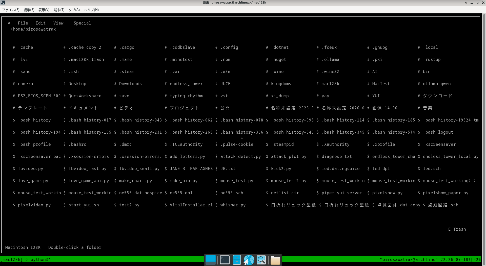

# like_a_mac128K TUI

A Macintosh 128K-inspired file manager for Linux terminals, written in Python and `curses`.

This project recreates the look and feel of the classic Macintosh Finder as a terminal-based user interface (TUI).

It is designed to run on ordinary Linux systems and small computers such as the Raspberry Pi Zero.

## Screenshot



> Screenshot optional. Place a screenshot named `screenshot.png` in the project directory.

---

## Features

### Desktop

* Macintosh 128K-style desktop
* File and folder icons
* Desktop file management
* Select files and folders
* Drag and drop
* Keyboard-mouse control

### Windows

* Open folders in Finder-style windows
* Multiple windows
* Active window handling
* Window dragging
* Window resizing
* Window closing
* File and folder scrolling
* Automatic window positioning

### File Operations

* Open files and folders
* Create new folders
* Rename files and folders
* Cut
* Copy
* Paste
* Move files and folders
* Delete to Trash
* Undo file operations
* Get Info

### Trash

* Macintosh-style Trash
* Move files to Trash
* Empty Trash
* Undo Trash operations

The project uses the standard XDG Trash location:

```text
~/.local/share/Trash/files
~/.local/share/Trash/info
```

`send2trash` is used when available, with an XDG-compatible fallback implementation.

### File Opening

The project can launch several types of files from the terminal.

Examples include:

* Text files
* Python files
* Shell scripts
* Images
* Audio files
* Video files
* Executable files

Terminal applications such as `nano` and `chafa` are used where appropriate.

---

## Keyboard Mouse

One of the goals of this project is to make the interface usable on computers where a real terminal mouse is unreliable.

The `keyboard_mouse.py` module converts keyboard input into virtual `curses` mouse events.

### Controls

| Key     | Function                        |
| ------- | ------------------------------- |
| `W`     | Move pointer up                 |
| `S`     | Move pointer down               |
| `A`     | Move pointer left               |
| `D`     | Move pointer right              |
| `Space` | Left click                      |
| `G`     | Press/release left mouse button |
| `↑`     | Scroll up                       |
| `↓`     | Scroll down                     |

The keyboard mouse allows operations such as:

```text
G
↓
W/A/S/D
↓
G
```

to simulate dragging an item.

This is particularly useful on Raspberry Pi systems where normal terminal mouse events may not work reliably.

---

## Current Status

The project is functional and has been tested on Arch Linux.

The following operations are currently working:

* Desktop navigation
* Folder windows
* Multiple windows
* File selection
* Folder selection
* Mouse interaction
* Keyboard mouse
* Drag and drop
* Window movement
* Window resizing
* File movement
* Desktop ↔ window movement
* Window ↔ window movement
* Desktop → Trash
* Empty Trash
* Undo
* Cut / Paste
* Copy / Paste
* Rename
* New Folder
* Get Info
* File opening

The project is still under development.

---

## Known Issues

### Raspberry Pi Zero keyboard mouse

The keyboard mouse works correctly on Arch Linux.

On a Raspberry Pi Zero, there is currently an issue where the `G` key does not behave correctly while `Space` can behave unexpectedly.

The same source code works correctly on Arch Linux, so this may be related to the Raspberry Pi terminal/curses environment.

Help from people familiar with:

* Python `curses`
* terminal input
* Raspberry Pi
* Linux TUI applications

would be appreciated.

---

## ASCII Mode

Unicode characters can be problematic on small Linux systems and terminal configurations.

The project therefore uses ASCII symbols for maximum compatibility.

Current file/folder symbols are:

```text
>  file

#  folder
```

Other interface elements also have ASCII equivalents.

The goal is to make the entire interface usable even on a minimal Raspberry Pi terminal.

---

## Project Structure

```text
mac128k/
│
├── main.py
├── events.py
├── desktop.py
├── filesystem.py
├── constants.py
├── keyboard_mouse.py
├── menu.py
├── trash.py
├── windows.py
│
├── mac128k_start.sh
├── chafa_video.sh

```

### `main.py`

Main application entry point.

Responsible for:

* curses initialization
* main event loop
* application state
* keyboard input
* keyboard mouse integration
* screen updates

### `events.py`

Handles user interaction and application events.

Examples:

* mouse events
* selection
* dragging
* dropping
* keyboard commands
* menu actions

### `desktop.py`

Draws and manages the Macintosh-style desktop.

Responsible for:

* desktop icons
* desktop selection
* desktop interaction

### `filesystem.py`

Provides filesystem-related functionality.

Responsible for:

* reading directories
* creating icons
* creating folders
* moving files
* copying files
* renaming files
* opening files

### `constants.py`

Contains interface constants and symbols.

Examples:

```text
FILE_SYMBOL
DIR_SYMBOL
TRASH_SYMBOL_EMPTY
TRASH_SYMBOL_FULL
POINTER_SYMBOL
```

The project currently favors ASCII symbols for compatibility.

### `keyboard_mouse.py`

Provides keyboard-controlled mouse emulation.

It converts keyboard commands into `curses` mouse events using:

```python
curses.ungetmouse()
```

### `menu.py`

Handles the Macintosh-style menu bar.

Current menus include:

```text
Apple
File
Edit
View
Special
```

### `trash.py`

Handles Trash functionality.

Includes:

* moving files to Trash
* emptying Trash
* restoring files through Undo

### `windows.py`

Handles Finder-style windows.

Includes:

* window creation
* window drawing
* window movement
* resizing
* scrolling
* active window management

---
## Requirements

### Required

* Linux
* Python 3
* `curses`
* `tmux`

`tmux` is currently required because Mac128K TUI launches external programs in separate terminal windows.

Install the basic requirements on Arch Linux:

```bash
sudo pacman -S python tmux
```

On Raspberry Pi OS / Debian:

```bash
sudo apt install python3 tmux
```

### Recommended

The following programs are used by some file-opening features:

* `nano`
* `chafa`
* `ffmpeg`

For example, on Arch Linux:

```bash
sudo pacman -S nano chafa ffmpeg
```

On Raspberry Pi OS / Debian:

```bash
sudo apt install nano chafa ffmpeg
```

### Optional

`send2trash` can be installed for Trash support:

```bash
pip install send2trash
```

The project also contains an XDG-compatible fallback, so `send2trash` is not strictly required.


## Running

Clone the repository:

```bash
git clone https://github.com/pirosawatrax/like_a_mac128k.git
cd mac128k
```

Run:

```bash
tmux
python3 main.py
```

If using the supplied startup script:

```bash
./mac128k_start.sh
```

Make it executable if necessary:

```bash
chmod +x mac128k_start.sh
```

---

## Raspberry Pi Zero

The project was also developed with Raspberry Pi Zero WH in mind.

A minimal Raspberry Pi OS installation can be used without a desktop environment.

The application is intended to run directly in a terminal.

For example:

```text
Raspberry Pi Zero
        │
        └── Raspberry Pi OS Lite
                  │
                  └── Terminal
                         │
                         └── Mac128K TUI
```

This makes it possible to use a Macintosh-style graphical interface concept on very small hardware without running a conventional graphical desktop environment.

---

## Philosophy

The goal is not to reproduce macOS.

Instead, this project explores what a Macintosh Finder-like interface might feel like when rebuilt entirely inside a Linux terminal.

The limitations of a TUI are part of the experiment.

```text
Macintosh 128K
      ↓
Finder
      ↓
Terminal
      ↓
Python + curses
      ↓
Mac128K TUI
```

The project also deliberately targets older and low-powered hardware such as the Raspberry Pi Zero.

---

## Contributing

Contributions, bug reports, ideas, and experiments are welcome.

In particular, help with the following would be appreciated:

* Raspberry Pi Zero `curses` input
* terminal mouse compatibility
* keyboard mouse improvements
* Finder-style UI improvements
* Raspberry Pi performance
* Unicode/ASCII terminal compatibility
* additional file operations

If you find a bug, please include:

1. Linux distribution
2. Python version
3. Terminal type

For example:

```bash
uname -a
python3 --version
echo "$TERM"
```

and describe the steps that reproduce the problem.

---


## License

Free to use, modify, and redistribute.

## Project Status

**Experimental / Work in Progress**

The project is usable, but development is ongoing.

The ultimate goal is a small, self-contained Macintosh-inspired TUI that can run comfortably on both a modern Linux desktop and tiny systems such as the Raspberry Pi Zero.
